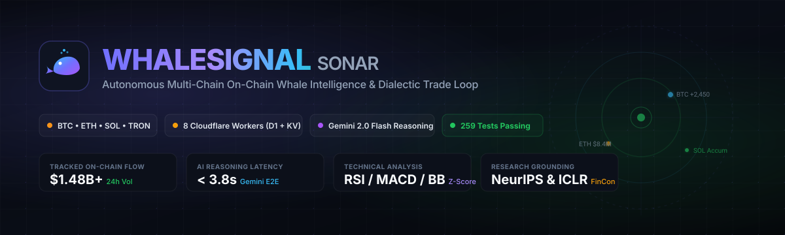
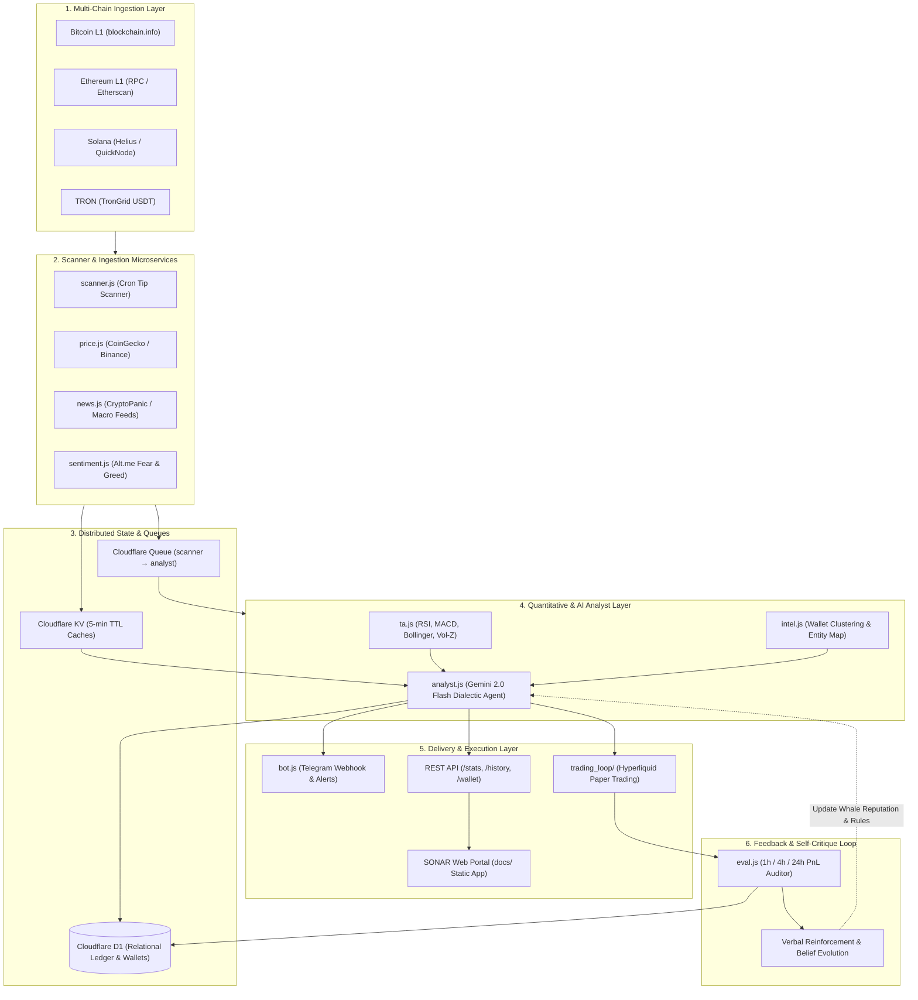

<p align="center">
  
</p>

<p align="center">
  <a href="https://github.com/Saman-ghorayshi/whalesignal/actions/workflows/daily.yml"></a>
  
  
  
  
  
  
  
  <a href="LICENSE"></a>
</p>

<p align="center">
  <a href="https://saman-ghorayshi.github.io/whalesignal/"><strong>🌐 Live Web Intelligence Portal (SONAR) &raquo;</strong></a> &nbsp;&bull;&nbsp;
  <a href="#-system-architecture"><strong>🏗️ Architecture &amp; 8 Microservices &raquo;</strong></a> &nbsp;&bull;&nbsp;
  <a href="#-research-grounding--trading-loop"><strong>📈 Quantitative Paper-Trading Loop &raquo;</strong></a> &nbsp;&bull;&nbsp;
  <a href="#-rest-api--telemetry"><strong>⚡ REST API &raquo;</strong></a>
</p>

---

## ⚡ Executive Summary

**WhaleSignal (SONAR)** is an institutional-grade, multi-chain on-chain whale intelligence system and dialectic trade evaluation loop running 100% serverless on Cloudflare infrastructure.

Traditional whale trackers (like *Whale Alert*) merely blast raw transaction notifications:
> *"10,000 ETH moved from Unknown Wallet to Binance."*

Raw alerts lack actionable value because they offer zero context. **WhaleSignal replaces noise with structured quantitative intelligence:**
1. **Who is moving?** Entity resolution attributing the counterparty (e.g. Wintermute market-maker sweep, Jump Trading OTC desk, or Binance cold vault replenishment).
2. **What is the market posture?** Real-time technical indicator confluence (RSI overbought/oversold, Volume Z-score spikes, MACD divergence, 200 EMA proximity, order-book depth).
3. **Why did they move?** Gemini 2.0 Flash synthesizes the counterparty's historical on-chain behavior with live macro news sentiment.
4. **Is it profitable to follow?** Autonomous dialectic bull/bear agent debates evaluate the trade, execute simulated positions on Hyperliquid testnet, and enforce self-critique verbal reinforcement loops (grounded in **NeurIPS 2024** and **ICLR 2024** research).

---

## 📱 Live Telemetry & Intelligence Sample

When a high-value on-chain transaction crosses block thresholds, WhaleSignal enriches, analyzes, and broadcasts structured intel:

```
🐳 WHALE INTELLIGENCE ALERT | #ETH
━━━━━━━━━━━━━━━━━━━━━━━━━━━━━━━━━━━━━━━━
💰 Volume:       4,850.00 ETH ($15,482,100 USD)
⛓️  Chain:        Ethereum L1 (Block #21,124,982)
📍 Flow:         0x3b89...49a1 (Jump Trading OTC) ➔ Kraken (Deposit)
📊 Market Confluence:
   • RSI (14):    74.8 [Overbought — Bearish Divergence]
   • Volume Z:    +3.82σ [High Anomalous Outflow]
   • 24h Delta:   +4.12% | Alt.me Fear & Greed: 78 (Extreme Greed)

🧠 GEMINI 2.0 SYNTHESIS:
"Heavy institutional exchange inflow following a +14% 3-day rally. 
Counterparty wallet has deposited to CEX 4 times in the past 90 days; 
each deposit was followed by a 3.2% - 5.8% local pullback within 6 hours."

⚖️ DIALECTIC AGENT VERDICT:
   [BEAR RESEARCHER]: Aggressive CEX inflow + RSI exhaustion + high Volume-Z.
   [BULL RESEARCHER]: High market momentum; potential liquidity absorption.
   👉 CONSENSUS: COPY_SHORT (Confidence: 81%, Leverage: 2x, SL: +1.8%)
━━━━━━━━━━━━━━━━━━━━━━━━━━━━━━━━━━━━━━━━
🔗 Tx: etherscan.io/tx/0x9a8f...4e12 • 🌐 sonar.internal/wallet/0x3b89
```

---

## 🏗️ System Architecture

WhaleSignal operates as a decoupled, multi-worker distributed pipeline running on Cloudflare Workers, Cloudflare D1 (Serverless SQLite), Cloudflare KV, and Cloudflare Queues.



---

## 🔬 Research Grounding & Trading Feedback Loop

Unlike naive copy-trading bots, WhaleSignal's trading execution engine implements patterns from published machine learning and quantitative finance literature:

### 1. Dialectic Bull / Bear Agent Debate
* **Research Origin**: *TradingAgents* (TauricResearch, arXiv:2412.20138).
* **Mechanism**: Before any trade execution decision (`COPY` vs `SKIP`), a bullish and a bearish reasoning agent debate the merits of the on-chain transfer. The analyst acts only when an asymmetric risk/reward edge survives counter-argument.

### 2. Conceptual Verbal Reinforcement (Self-Critique)
* **Research Origin**: *FinCon* (NeurIPS 2024).
* **Mechanism**: After every trading episode, the auditor worker evaluates the real-world price delta at $T+1\text{h}$, $T+4\text{h}$, and $T+24\text{h}$. If a signal fails, the model performs verbal self-critique and writes natural-language "beliefs" (e.g. *"Wallet 0x9f... frequently performs fake-out deposits prior to further upside"*), storing them in long-term D1 memory.

### 3. Layered Short/Long-Term Memory
* **Research Origin**: *FinMem* (ICLR 2024).
* **Mechanism**: Separates ephemeral transaction history (short-term) from global wallet reputation profiles and macro regime notes (long-term). Every prompt loads both tiers before synthesis.

---

## ⚡ The 8 Cloudflare Microservices

| Microservice | Config | Trigger | Purpose |
| :--- | :--- | :--- | :--- |
| **`scanner`** | [`wrangler.scanner.toml`](file:///C:/Users/Samsha/Documents/whalesignal/wrangler.scanner.toml) | Cron (`* * * * *`) | Scans BTC, ETH, Solana, and TRON tips for high-volume transactions ($500k+). |
| **`analyst`** | [`wrangler.analyst.toml`](file:///C:/Users/Samsha/Documents/whalesignal/wrangler.analyst.toml) | Queue Consumer | Enriches alerts with TA indicators, executes Gemini 2.0 reasoning, and commits predictions. |
| **`bot`** | [`wrangler.bot.toml`](file:///C:/Users/Samsha/Documents/whalesignal/wrangler.bot.toml) | HTTP / Webhook | Serves the Telegram bot command interface and delivers real-time formatted channel alerts. |
| **`eval`** | [`wrangler.eval.toml`](file:///C:/Users/Samsha/Documents/whalesignal/wrangler.eval.toml) | Cron (`0 * * * *`) | Evaluates signal price outcomes at 1h, 4h, and 24h horizons; computes win-rates and accuracy. |
| **`price`** | [`wrangler.price.toml`](file:///C:/Users/Samsha/Documents/whalesignal/wrangler.price.toml) | Cron (Every 2m) | Maintains low-latency multi-asset spot and futures price caches in Cloudflare KV. |
| **`news`** | [`wrangler.news.toml`](file:///C:/Users/Samsha/Documents/whalesignal/wrangler.news.toml) | Cron (Every 5m) | Ingests, dedupes, and scores global crypto headlines for immediate contextual grounding. |
| **`sentiment`** | [`wrangler.sentiment.toml`](file:///C:/Users/Samsha/Documents/whalesignal/wrangler.sentiment.toml) | Cron (Every 15m) | Caches Fear & Greed indices and funding rates to gauge systemic market positioning. |
| **`health`** | [`wrangler.health.toml`](file:///C:/Users/Samsha/Documents/whalesignal/wrangler.health.toml) | HTTP / Cron | Telemetry watchdog monitoring worker uptime, KV write limits, and D1 storage quotas. |

---

## 🌐 Live Web Intelligence Portal (SONAR)

The static web application located in [`docs/`](file:///C:/Users/Samsha/Documents/whalesignal/docs/) connects to the live backend REST API to provide a comprehensive radar interface:

* **[Overview (`index.html`)](https://saman-ghorayshi.github.io/whalesignal/)**: Real-time streaming feed of analyzed whale alerts with visual sentiment pills and transaction links.
* **[Quantitative Accuracy (`stats.html`)](https://saman-ghorayshi.github.io/whalesignal/stats.html)**: Live statistical scorecard tracking signal win-rates, 24h volume, and accuracy by token.
* **[Wallet Profiler (`wallet.html`)](https://saman-ghorayshi.github.io/whalesignal/wallet.html)**: Deep-dive inspector analyzing any source/destination wallet's historical flows and label history.
* **[Telemetry Monitor (`monitor.html`)](https://saman-ghorayshi.github.io/whalesignal/monitor.html)**: Live infrastructure health dashboard tracking Cloudflare queue depth and rate-limit quotas.

---

## 📡 REST API Reference

WhaleSignal exposes a zero-dependency JSON REST API via the `bot` / `api` worker:

### `GET /stats`
Returns aggregated 24-hour volume, signal distribution, and model accuracy metrics:
```json
{
  "ok": true,
  "volume_24h_usd": 1482910000,
  "alerts_24h": 142,
  "accuracy": {
    "total_evaluated": 318,
    "correct": 236,
    "rate": 74.21
  },
  "chains": { "btc": 48, "eth": 62, "sol": 21, "tron": 11 }
}
```

### `GET /history?page=1&limit=20`
Returns paginated historical whale transactions with AI interpretations and realized price deltas.

### `GET /wallet/:address`
Inspects on-chain metadata, known exchange tags, and total historical inflow/outflow for a specific address.

---

## 🧪 Comprehensive Automated Test Matrix

WhaleSignal maintains **259 passing unit, integration, and security tests** across 20 distinct suites with 0 external mocking dependencies:

```bash
node tests/run_tests.js
```

```
✔ sourceInterval: fast outlets 2min, macro 15, Fed/SEC 60 (6ms)
✔ buildPrompt always contains all structural anchors the AI needs (67ms)
✔ parseAnalysis clamps confidence to [0,1] and rejects unknown signals (1ms)
✔ applySemanticGuards downgrades contradictions and caps by evidence (1ms)
✔ analyzeOne: template bearish broadcasts exactly once (2207ms)
✔ sma / ema / rsi / macd / bollinger / volumeZ: verified indicators (7ms)
✔ fetchTronEvents: live TronGrid returns Transfer events (1077ms)
✔ GET /stats, /history, /wallet/:address REST endpoints verified (64ms)
✔ eval logic: bullish + price up = correct, bearish + price down = correct (2ms)
✔ D1 safe mode: quota protection, rate-limit backoff & deadlock guards (15ms)

Total: 259 passing (0 failures, 100% green suite)
```

---

## 🚀 Deployment & Operations

### 1. Interactive Setup Wizard
Configure all API keys (Gemini, Telegram, Blockchain RPCs) with automated validation:
```bash
python wizard.py
```

### 2. One-Shot Cloudflare Deployment
Automatically provisions D1 databases, sets up KV namespaces, binds Queues, executes schema migrations, seeds 500+ known exchange addresses, and deploys all 8 workers:
```bash
python deploy_all.py
```

### 3. Verify Health & Logs
```bash
npx wrangler tail whalesignal-scanner
npx wrangler tail whalesignal-analyst
```

---

## 📄 License & Attribution

WhaleSignal is open-source software licensed under the **[MIT License](LICENSE)**.

Architected and engineered by **[Saman Ghorayshi](https://github.com/Saman-ghorayshi)**.
